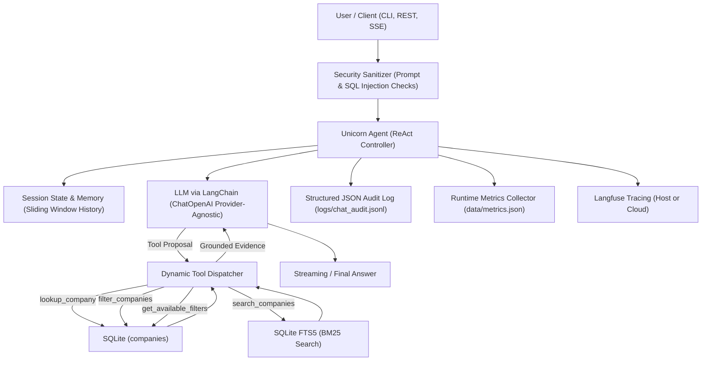

# Indian Unicorn Startups AI Chatbot

A production-grade, grounded conversational AI assistant that answers questions about 118 Indian unicorn startups strictly from a structured dataset using **LangChain**, **FastAPI**, **SQLite (with FTS5 Full-Text Search)**, and **Langfuse Tracing**.

---

## 🌟 Key Highlights

- **Strict Dataset Grounding**: Zero hallucinations. Relies strictly on SQLite data; transparently communicates unrecorded metrics and handles out-of-dataset entities gracefully.
- **Dynamic Retrieval**: 100% data-driven tools with zero hardcoded company or sector mappings.
- **Conversational Memory**: Retains multi-turn conversation context, resolves pronouns and anaphora, and avoids redundant database queries.
- **Real-Time Streaming**: Server-Sent Events (SSE) token-by-token streaming with live reasoning/thought token capture.
- **Clarification Triggers**: Automatically cross-questions users on subjective, ambiguous, or underspecified queries.
- **Security & Sanitization**: Guardrails against prompt injection, SQL injection neutralization, length capping, and Unicode normalization.
- **Production Observability**: Full trace capture with Langfuse, structured append-only JSON audit logs, and runtime telemetry metrics endpoints.

---

## 🏗 System Architecture



---

## 🚀 Quickstart

### 1. Installation

```bash
# Clone repository and navigate to folder
cd ai_chatbot

# Create and activate virtual environment
python3 -m venv myenv
source myenv/bin/activate

# Install dependencies
pip install -r requirements.txt
```

### 2. Environment Configuration

Copy the template and fill in your keys:
```bash
cp .env.example .env
```

Configure `.env`:
```ini
# Kaggle API token (required only once to download the raw dataset)
KAGGLE_API_KEY="your-kaggle-api-key"

# LLM Provider (OpenAI, Mistral, NVIDIA NIM, vLLM, Ollama, etc.)
LLM_BASE_URL="https://api.mistral.ai/v1"
LLM_API_KEY="your-api-key"
PRIMARY_MODEL="open-mistral-nemo"
FALLBACK_MODELS="mistral-small-latest"
LLM_TEMPERATURE=0.2
LLM_TIMEOUT=30.0

# Observability (Self-Hosted Local Docker or Langfuse Cloud)
LANGFUSE_PUBLIC_KEY="pk-lf-local-unicorns"
LANGFUSE_SECRET_KEY="sk-lf-local-unicorns"
LANGFUSE_HOST="http://localhost:3000"
```

### 3. Build Database

```bash
python data/create_dataset.py
```
This cleans the dataset, normalizes schema inconsistencies, and creates `data/processed/companies.db` with indexed attributes and an FTS5 full-text search table.

---

## 💻 Usage & Interfaces

### 1. Interactive Terminal CLI
```bash
python cli.py
```
- Type natural questions directly in the terminal.
- Commands: `reset` (clear conversation history), `exit` (quit).

### 2. FastAPI REST & Streaming Server
```bash
uvicorn api:app --reload --port 8000
```
- **Interactive Swagger Docs**: [http://localhost:8000/docs](http://localhost:8000/docs)
- **ReDoc Documentation**: [http://localhost:8000/redoc](http://localhost:8000/redoc)

#### Core Endpoints:
| Method | Endpoint | Description |
|---|---|---|
| `POST` | `/chat` | Synchronous conversation turn with latency, tool payloads, and Langfuse trace metadata |
| `POST` | `/chat/stream` | Server-Sent Events (SSE) token and reasoning token streaming |
| `GET` | `/health` | Service and SQLite database connectivity status |
| `GET` | `/sessions` | List active in-memory conversation sessions |
| `GET` | `/sessions/{id}` | Retrieve conversation turn history for a session |
| `POST` | `/sessions/{id}/reset` | Reset a session's conversational memory |
| `GET` | `/metrics` | Real-time aggregated latency, token counts, and tool metrics |
| `GET` | `/logs/latest?n=5` | Structured JSON audit trail inspection |

### 3. End-to-End Live API Test Suite
Verify all 9 capabilities against the running server in one command:
```bash
python testing_api.py
```

---

## 🐳 Docker Deployment

The deployment separates the **application service** from the **observability stack** for maximum modularity:

### Application Container
Deploy the containerized FastAPI chatbot:
```bash
docker compose up -d --build
```
- Chatbot API: [http://localhost:8000](http://localhost:8000)
- Auto-configured to route local traces to `host.docker.internal:3000`.

### Local Langfuse Stack (Optional)
Run the self-hosted Langfuse stack (ClickHouse, Postgres, Redis, MinIO, Web UI):
```bash
docker compose -f deploy/docker-compose.langfuse.yml up -d
```
- Web UI: [http://localhost:3000](http://localhost:3000) (Default login: `admin@local.host` / `adminpassword123`)

---

## 📋 Live Model Capabilities Showcase ([TEST_QUERIES.md](TEST_QUERIES.md))

For complete evaluation logs and live agent outputs across all test queries, see [**TEST_QUERIES.md**](TEST_QUERIES.md):

| Category | Capability | Demonstrated Behavior |
|---|---|---|
| **1. Factual Company Lookups** | Single-entity retrieval & metric extraction | Grounded lookups for Razorpay, Zepto, Zerodha, and overseas-relocated Postman. |
| **2. Exploratory & Filtering Queries** | Multi-condition filtering & schema inspection | Autonomous schema fallback (`fintech` → payments, lending, banking tech) and 56 distinct sector listings. |
| **3. Free-Text Semantic Search (FTS)** | Unstructured company background search | FTS5 BM25 search across EV mobility (Ather, Ola Electric), logistics (Delhivery, XpressBees), and gaming (Hike, MPL, Dream11). |
| **4. Conversational Memory & Context Re-use** | Multi-turn state & anaphora resolution | Zero-tool follow-ups ("Which of these are in Bangalore?"), sub-second memory answers, Zerodha vs Groww comparison. |
| **5. Ambiguity & Cross-Questioning** | Subjective query handling | Proactive cross-questioning on broad advice ("Which company is best to collaborate with?"), disambiguating "most successful". |
| **6. Typo Tolerance & Fuzzy Matching** | Phonetic & string distance matching | Auto-corrects `Razorypay` → Razorpay, normalizes `Byjus` → BYJU'S, resolves substring `1mg` → Tata 1mg. |
| **7. Out-of-Dataset & Missing Fields** | Grounding & hallucination prevention | Refuses to hallucinate external companies (Stripe, OpenAI); transparently reports bootstrapped status for Zerodha. |
| **8. Security & Input Sanitization** | Prompt injection & SQL injection defense | Blocks jailbreaks in **33.8ms**, neutralizes SQL injection (`DROP TABLE`), and strips control characters safely. |

👉 **Read the full showcase with exact prompts, tool payloads, and outputs in [TEST_QUERIES.md](TEST_QUERIES.md).**

---

## 🧪 Automated Testing

Run the full offline test suite (95 tests):
```bash
pytest -v
```

| Suite | Tests | Scope |
|---|---|---|
| `tests/test_create_dataset.py` | 35 | Kaggle download, text cleaning, SQLite creation, missing value masks |
| `tests/test_tools.py` | 28 | Exact lookups, fuzzy matching, parameterized filters, SQL injection safety |
| `tests/test_agent.py` | 10 | ReAct loop, history trimming, clarification detection, streaming tokens |
| `tests/test_api.py` | 7 | REST endpoints, SSE token streaming, session reset, health checks |
| `tests/test_config.py` | 6 | Settings validation, fallback models, provider setup |
| `tests/test_sanitizer.py` | 5 | Unicode normalization, length truncation, prompt injection filters |
| `tests/test_observability.py` | 4 | JSONL audit logs, metrics computation, Langfuse handler dispatch |

---

## 📁 Project Structure

```text
ai_chatbot/
├── config/                  # Settings and provider-agnostic ChatOpenAI factory
│   ├── settings.py
│   └── provider.py
├── data/                    # Dataset extraction, cleaning, and SQLite database
│   ├── create_dataset.py
│   └── processed/
│       ├── companies.db     # SQLite database with FTS5 search table
│       └── tracxn.csv       # Cleaned dataset CSV
├── agent/                   # Agent core, system prompts, and conversational memory
│   ├── agent.py
│   ├── prompts.py
│   └── state.py
├── tools/                   # Dynamic database tools (lookup, filter, FTS, schema)
│   └── db_tools.py
├── security/                # Sanitization and prompt injection guardrails
│   └── sanitizer.py
├── observability/           # Langfuse tracing, JSON audit logging, and metrics
│   ├── tracer.py
│   ├── logger.py
│   └── metrics.py
├── deploy/                  # Production Docker Compose for local Langfuse
│   └── docker-compose.langfuse.yml
├── tests/                   # 95 unit and integration tests
├── Dockerfile               # Production container definition for FastAPI app
├── docker-compose.yml       # Application deployment compose file
├── api.py                   # FastAPI REST and SSE streaming server
├── cli.py                   # Interactive terminal chat interface
├── testing_api.py           # Live end-to-end API test script
├── TEST_QUERIES.md          # Live model performance and capability showcase
├── requirements.txt         # Production dependencies
└── README.md                # Project documentation
```
